<div align="center">

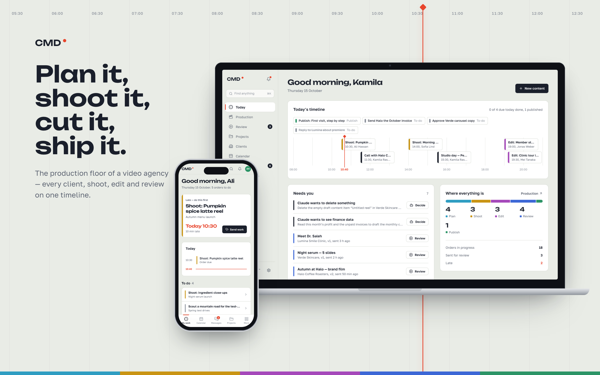

# CMD Production Suite

Management software for a video and marketing production agency, from the first idea to the published post.


[The problem](#the-problem) · [The solution](#the-solution) · [Product tour](#product-tour) · [Architecture](#architecture) ·
[Engineering decisions](#engineering-decisions) · [Challenges](#challenges-and-how-they-were-solved) · [Getting started](#getting-started)

</div>

## Overview

CMD Production Suite runs a video and social-media production agency. It covers:
- clients and projects
- every piece of content as it moves through plan → shoot → edit → review → publish
- the crew doing the work and their conversations
- the money

A working agency uses it every day, in English and Russian, on desktop and on the phone.

The interface is modelled on an edit suite. Each piece of content is a track on a timeline, a red playhead marks the current time, and the five stage colours come from the SMPTE colour bars that video professionals use to calibrate equipment.

> Every name, client and number shown in this README is fictional.

## The problem

Before CMD, the agency ran on group chats, spreadsheets and memory. As the client list grew, the same problems kept coming back.

| | Problem | Impact |
|---|---|---|
| 1 | Nobody had one view of production. The state of each reel, film or carousel was spread across different chats. | The owner had to ask around to find out where things stood. |
| 2 | Hand-offs were unclear. Editors did not know when footage was ready, and videographers did not know what came next. | Work sat idle between stages and deadlines slipped. |
| 3 | Large files had no proper channel. Messengers compress video and cap file sizes, and drives handed over in person left no record. | Versions got lost, exports were redone, and people argued about which file was final. |
| 4 | Feedback was written in chat, away from the video ("the logo at the end is too short"). | Revisions took several rounds and approvals were hard to trace. |
| 5 | Income, costs and unpaid invoices were tracked by hand. | Profit was known only at month end, and overdue invoices were missed. |
| 6 | The team speaks two languages and mostly works from phones. | The crew did not adopt desktop-only, English-only tools. |

## The solution

| | Solution | Result |
|---|---|---|
| 1 | A production timeline shows every content item as a track that has moved as far as its current stage. The owner's home screen is a live timeline of the day and a list of what is waiting for them. | One screen shows where everything is and what needs attention now. |
| 2 | Each item has a shoot order and an edit order, each with its own assignee and deadline. The edit unlocks when the shoot is approved, and the people involved get a Telegram message. | Work moves to the next stage as soon as it is approved, and late work shows in red. |
| 3 | Resumable uploads of up to 500 MB go straight to object storage. Drives handed over in person are recorded and confirmed on receipt. | Every version is stored and numbered, and no file goes through a messenger. |
| 4 | The review screen plays video and shows images, with notes pinned to exact moments, version history and approve or send-back decisions. | Comments point at the exact frame and every decision is recorded. |
| 5 | The finance page shows this month's profit on an accrual or cash basis, money owed in both directions with a one-click "paid", a twelve-month trend and profit per project. | The owner can check profit and unpaid invoices at any time. |
| 6 | The interface, notifications and Telegram messages follow each person's language setting. Videographers and editors open on a phone-friendly "My work" page that shows their next task first. | The crew uses it on set, in their own language. |

The agency also asked for two additions: Claude as an assistant that can work inside CMD with limits on what it may do, and Notion-style notes for briefs, shoot plans and meeting notes.

## Product tour

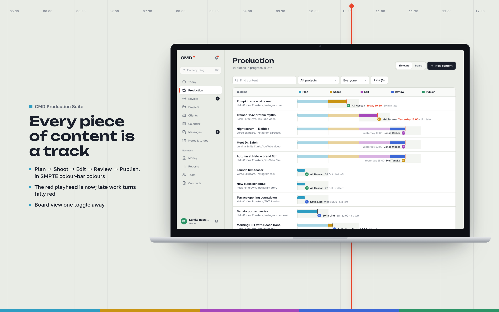
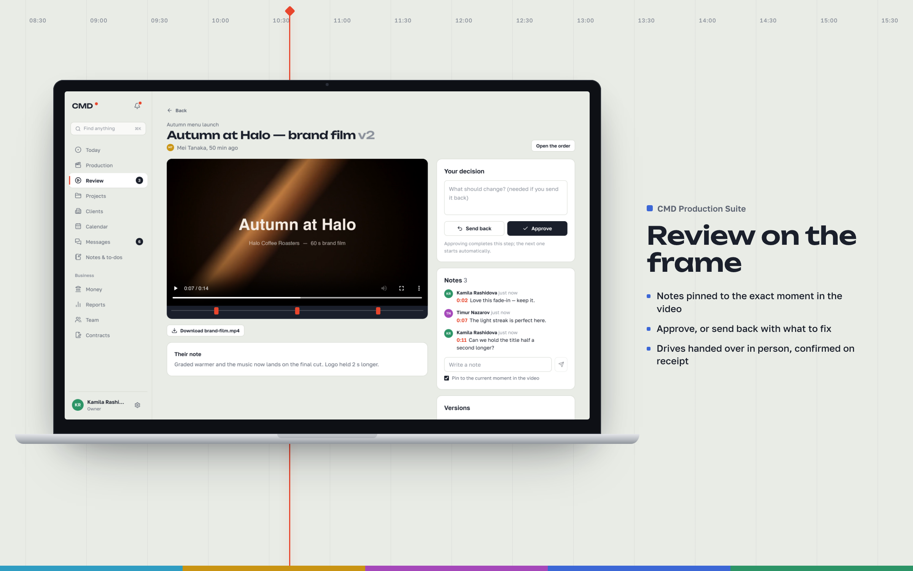
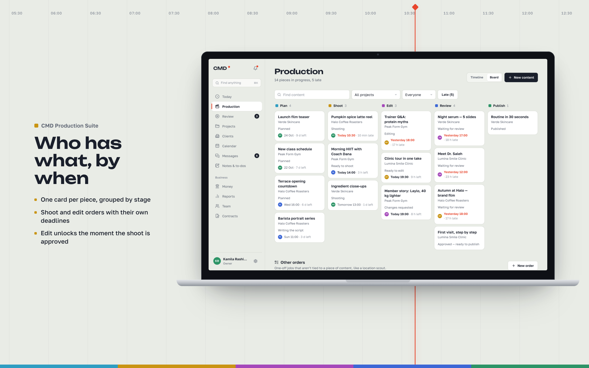
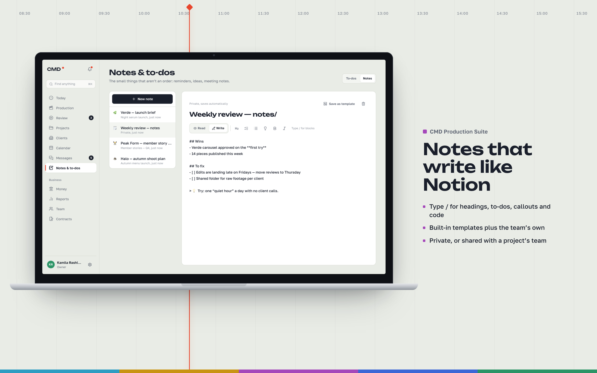
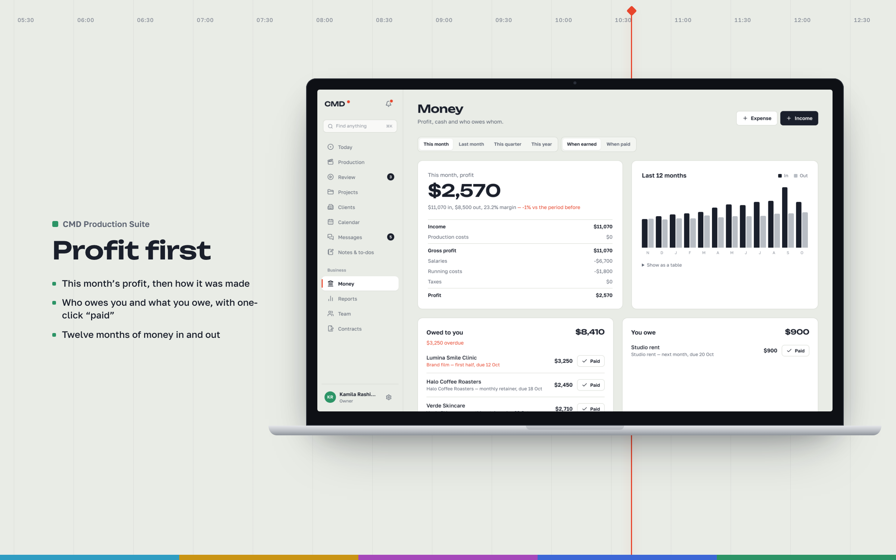
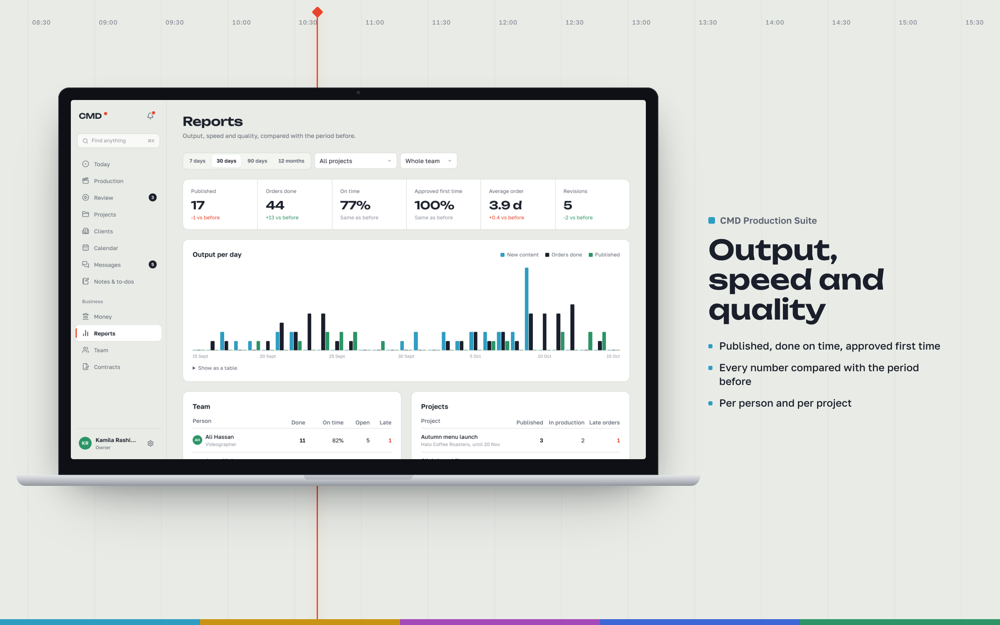
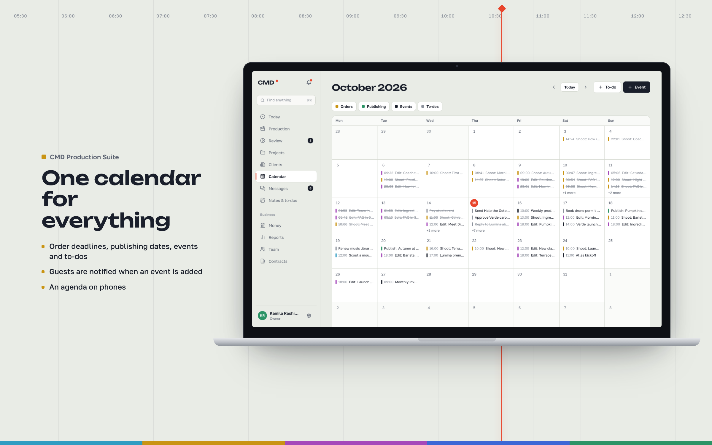
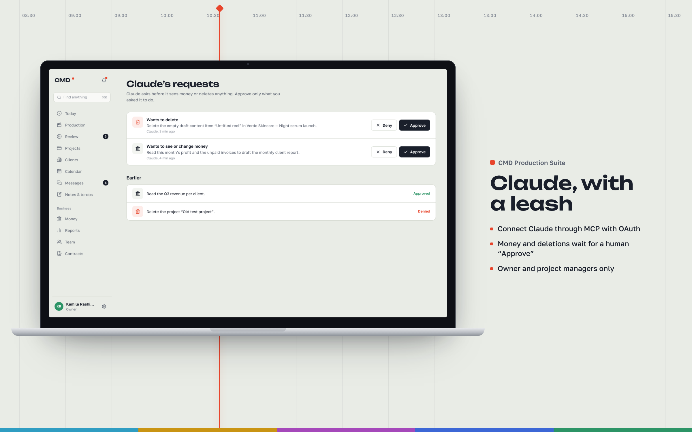
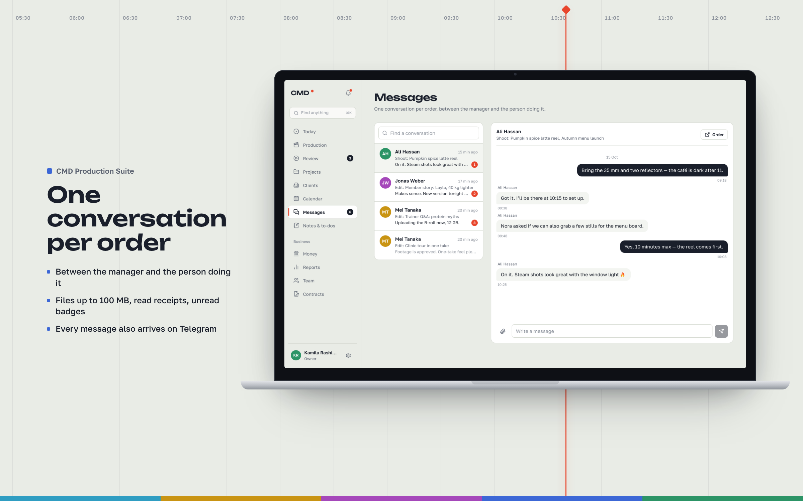
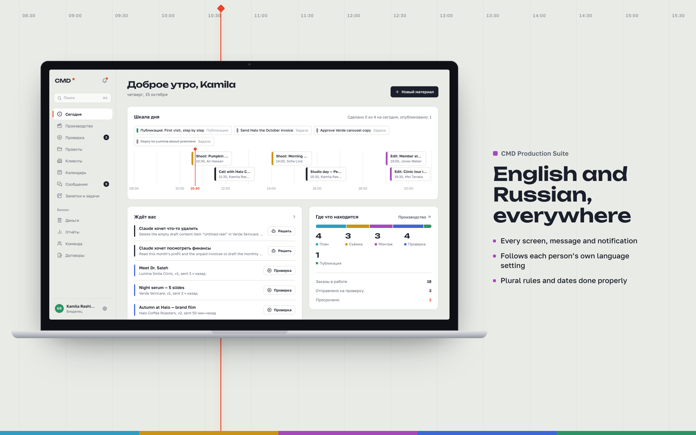

### On the phone

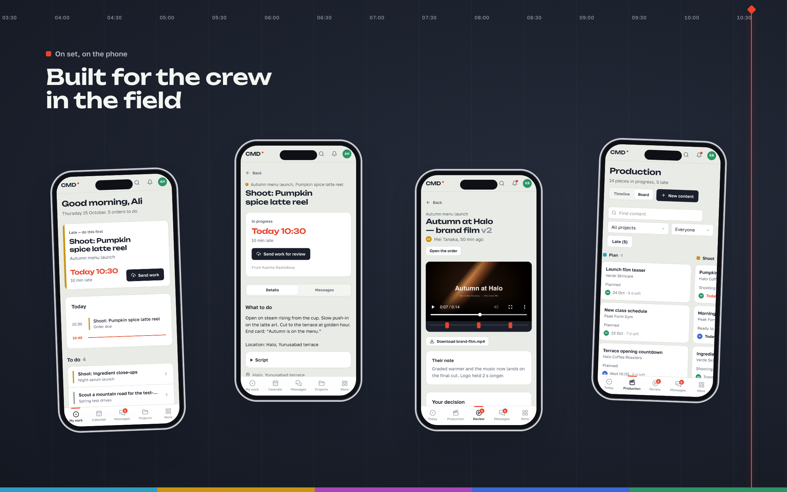

### Screens

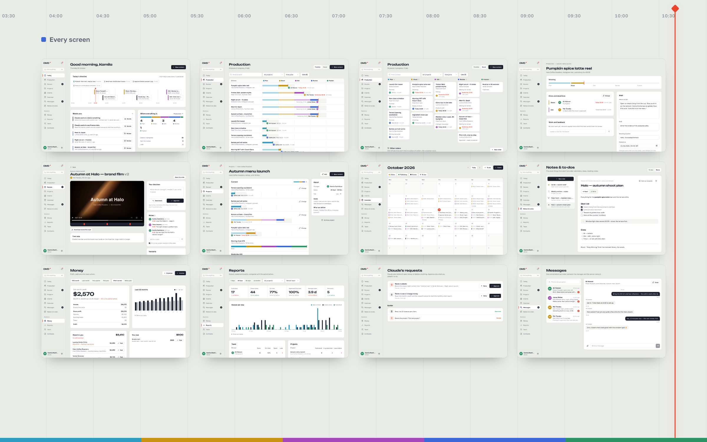

## Features

| Area | What it does |
|---|---|
| Production | Content items, shoot and edit orders with dependencies and deadlines, reassignment, checklists, one-off orders, timeline and board views |
| Review | Resumable multipart uploads, video and image review, notes pinned to timestamps, versions, approve or send back, in-person drive handover |
| Collaboration | A conversation for each order with attachments and unread counts, notifications, and a ⌘K command bar that searches everything |
| Workspace | To-dos with dates, a shared calendar, Markdown notes with a slash menu, built-in and team templates |
| Business | Clients, projects (archived before they can be deleted), contracts with print-to-PDF, finance, reports, team management |
| Telegram | Notifications, deadline reminders, approve buttons in the message, two-step sign-in codes |
| AI | A Model Context Protocol (MCP) server for Claude, with OAuth, role checks and human approval for sensitive actions |
| Languages | English and Russian in the interface, server messages and notifications, with correct plural forms |

## Design

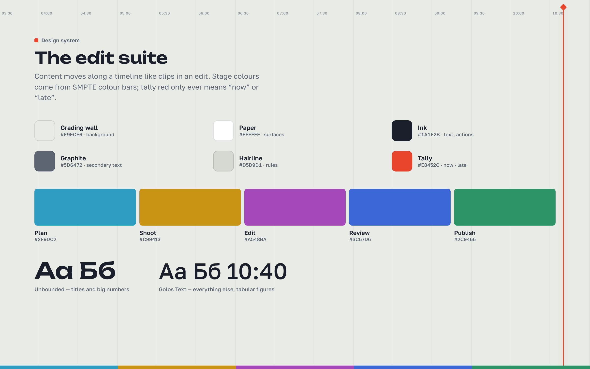

The design system has few rules. The five stage colours are the only saturated colours, and tally red only ever means "now" or "late". Titles and large numbers use Unbounded; everything else uses Golos Text. Both fonts cover Cyrillic, and times and amounts use tabular figures. Layout relies on hairlines and alignment, and only elements that float above the page, such as menus and dialogs, have shadows.

## Architecture

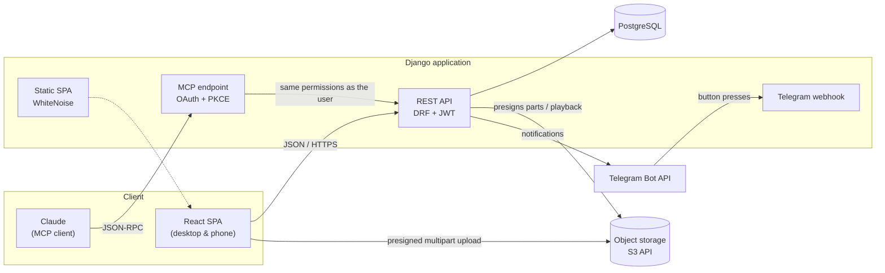

The application ships as one container. A Node stage builds the React app, and a Python stage serves the API and the built files with Gunicorn and WhiteNoise. Migrations run on start-up, so the database schema always matches the code.

## Engineering decisions

| Decision | Reason |
|---|---|
| Django REST Framework and a React SPA, deployed as one service | There is one thing to deploy and one origin, so production needs no CORS, and the server sets security headers on every page. |
| Business rules live on the server | The API enforces roles, order dependencies, archive-before-delete and the approval checks. The interface only displays them, so a custom client or Claude cannot get around them. |
| Uploads go straight to object storage | The server only signs the upload parts. Video never passes through the application server, and an upload resumes after a dropped connection. |
| Telegram carries notifications | The crew already uses Telegram. Each notification has a button that opens the right page, and the same bot sends two-step sign-in codes. |
| Claude connects through the Model Context Protocol | Claude calls the same API with the same permissions as the person who connected it. |
| Notes are plain Markdown | Notes can be exported and read anywhere. The renderer builds React elements and never inserts HTML, so a note cannot run a script. |
| The design system has a few tokens with fixed meanings | A large interface stays consistent and quick to read. |

## Challenges and how they were solved

| Challenge | Solution |
|---|---|
| Crew members upload files of up to 500 MB over unreliable mobile connections. | Uploads use S3 multipart with presigned parts, retries and resume. A storage quota removes the oldest files that have already been reviewed. |
| An AI agent needed access to the data without full control over it. | Claude connects through OAuth with dynamic client registration and PKCE. Reading financial data or deleting anything waits until a person approves it in the app or in Telegram, and each approval applies only to that exact request. Only the owner and project managers can connect Claude. |
| A small team still needs proper account security. | Sign-in is rate limited per IP and per user, and the limit is checked before the password is hashed. Two-step sign-in with a Telegram code is optional. Access tokens last 30 minutes, and refresh tokens rotate on every use and are revoked on sign-out. The server sends strict CSP, HSTS and Permissions-Policy headers. |
| Russian has three plural forms, and some English words have two meanings (*Edit* the action and *Edit* the stage). | The translation helpers handle plurals, context keys separate ambiguous words, and the server uses gettext, so each notification arrives in its recipient's language. |
| Russian text is longer than English and overflowed buttons and cards at some screen widths. | An automated check measured every piece of text against its container on every page, at four screen widths, in both languages. The fixes went into shared components: buttons that wrap, deadlines that break onto a new line, and container queries so the timeline adapts to the space it has. |
| A new major version of the upload library made the upload dialog fail as it opened. | The failure was reproduced with browser automation, the library was pinned to the last working version, and a real upload was tested end to end. |
| Deleting live client data by mistake would be costly. | A project must be archived before it can be deleted, and only the owner can delete it. Every destructive action asks for confirmation in the app. |

## Quality

The backend has 79 tests. They cover the production workflow and permissions, finance, reports, video review, Telegram, security and the MCP connector. ESLint checks the frontend. During development, browser automation was used to check layout across languages and screen sizes and to test uploads end to end.

```sh
.venv/bin/pip install -r backend/requirements-dev.txt
.venv/bin/python backend/manage.py test api
cd frontend && npm run lint
```

## Tech stack

| Layer | Technology |
|---|---|
| Backend | Python 3.13, Django 6, Django REST Framework, SimpleJWT, boto3, Gunicorn, WhiteNoise |
| Frontend | React 19, React Router 7, Vite 8, Tailwind CSS 4, zustand, Uppy, lucide, Fontsource (Unbounded, Golos Text) |
| Data | PostgreSQL in production, SQLite locally, S3-compatible object storage |
| Integrations | Telegram Bot API, Model Context Protocol (Claude) |
| Delivery | Docker (multi-stage) |

## Project structure

```
cmd-production-suite/
├── backend/
│   ├── api/                 Domain models, REST views, workflow, finance, reports,
│   │   │                    video storage, Telegram, OAuth + MCP, security
│   │   ├── migrations/
│   │   ├── management/      telegram_setup, video_cleanup
│   │   ├── templates/       OAuth consent page
│   │   └── tests/
│   ├── cmd_agency/          Settings, URLs, WSGI
│   └── locale/ru/           Server-side Russian translations
├── frontend/
│   └── src/
│       ├── pages/           One file per screen
│       ├── features/        Shared flows: send work, change orders, chat, notes editor
│       ├── shell/           Navigation, command bar
│       ├── ui/              Design-system components
│       ├── lib/             API client, auth, i18n, formatting, hooks
│       └── locales/         Russian dictionary
├── docs/mockups/            Images used in this README
└── Dockerfile
```

## Getting started

You need Python 3.13 and Node.js 22.

```sh
python3.13 -m venv .venv
.venv/bin/pip install -r backend/requirements.txt
.venv/bin/python backend/manage.py migrate
.venv/bin/python backend/manage.py createsuperuser
.venv/bin/python backend/manage.py runserver 8000
```

In a second terminal:

```sh
cd frontend
npm ci
npm run dev
```

Open http://localhost:5173 and sign in with the account you created. The first account is the owner. The development server forwards API requests to Django on port 8000. Video uploads need S3-compatible storage (the `R2_*` variables), and Telegram features need a bot token (the `TELEGRAM_*` variables).

### Production configuration

The application reads its configuration from environment variables. [`.env.example`](.env.example) lists all of them, for the database, object storage, Telegram, email and security settings.

Build and run the container:

```sh
docker build -t cmd-production-suite .
docker run --env-file .env -p 8000:8000 cmd-production-suite
```

## License

Copyright © 2026 Samandar Erkinov. All rights reserved. This repository is published for viewing only. It may not be used, copied, modified or distributed without written permission. See [LICENSE](LICENSE).
